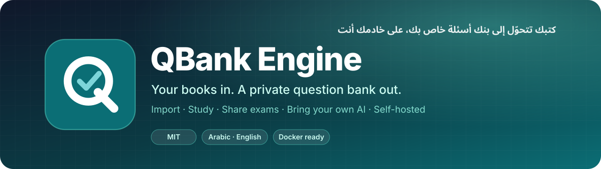
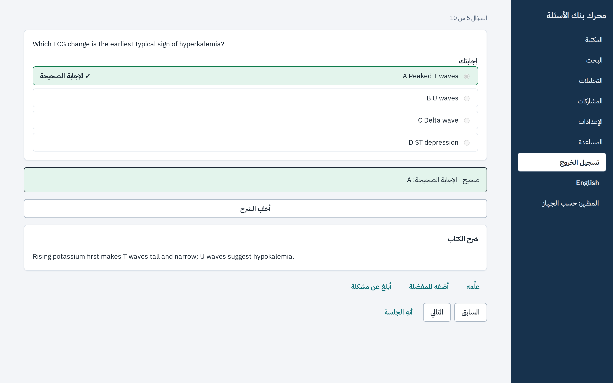
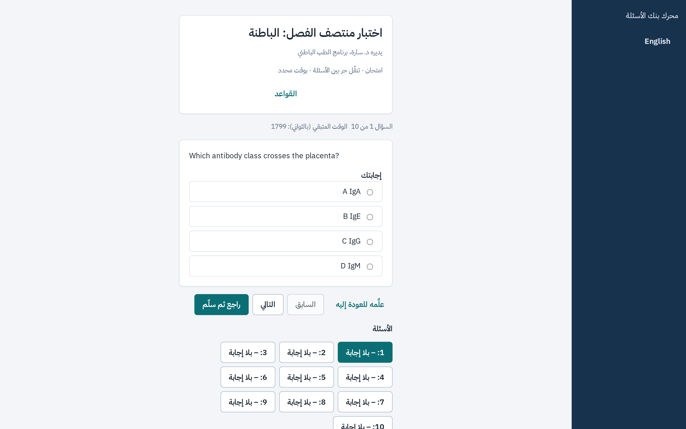
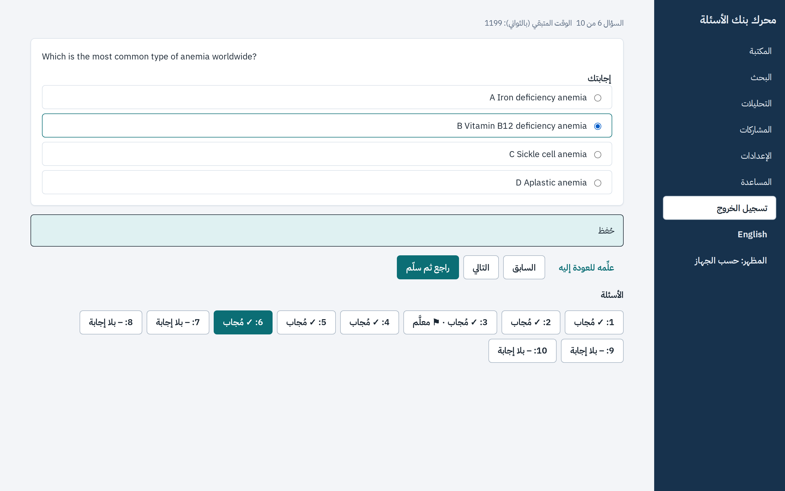
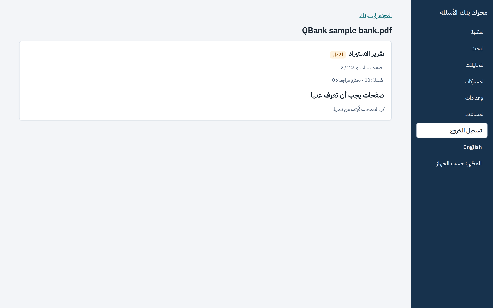
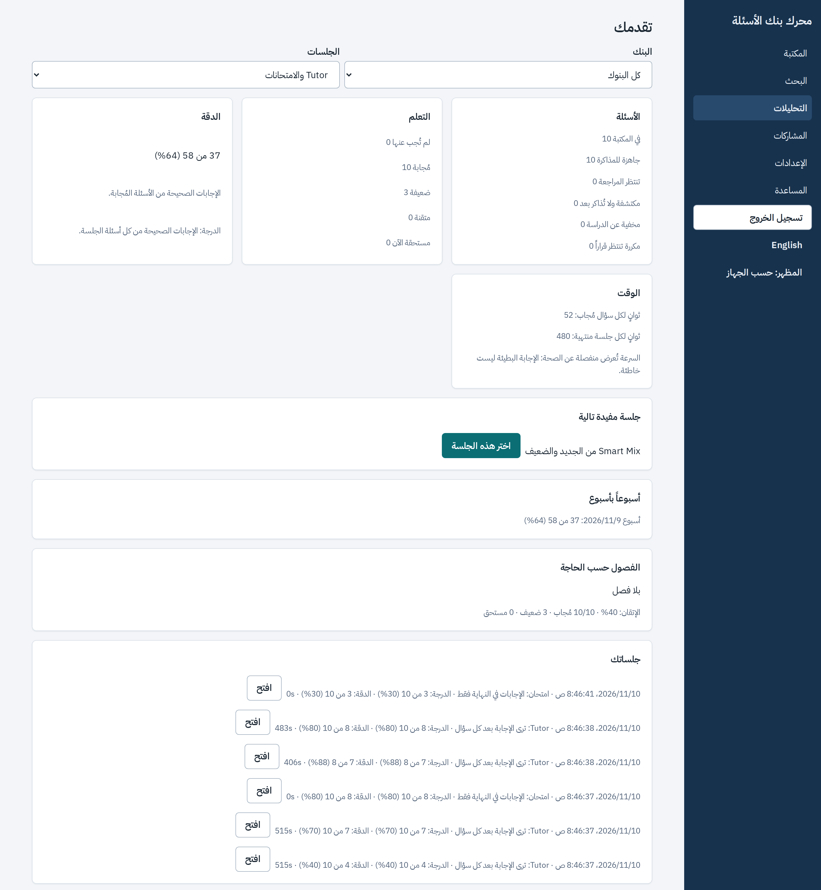
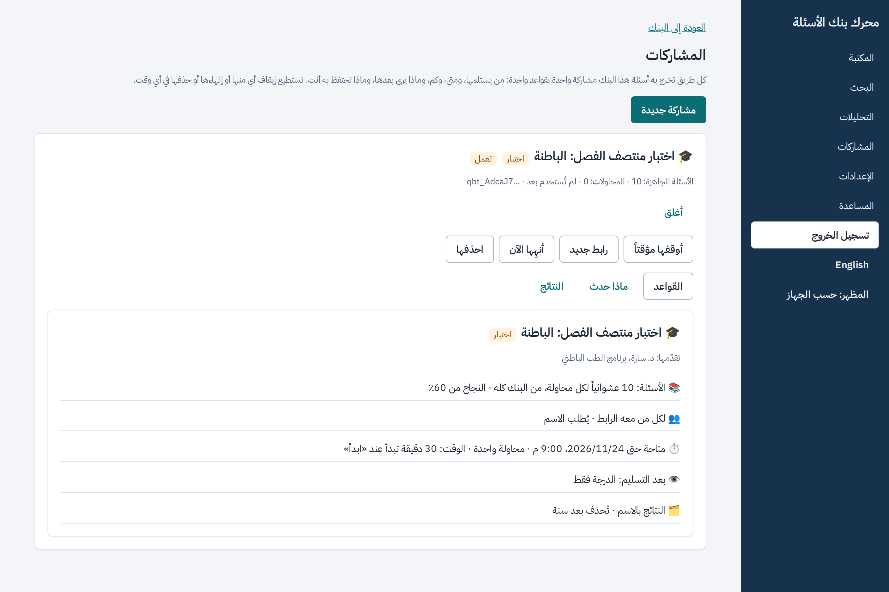
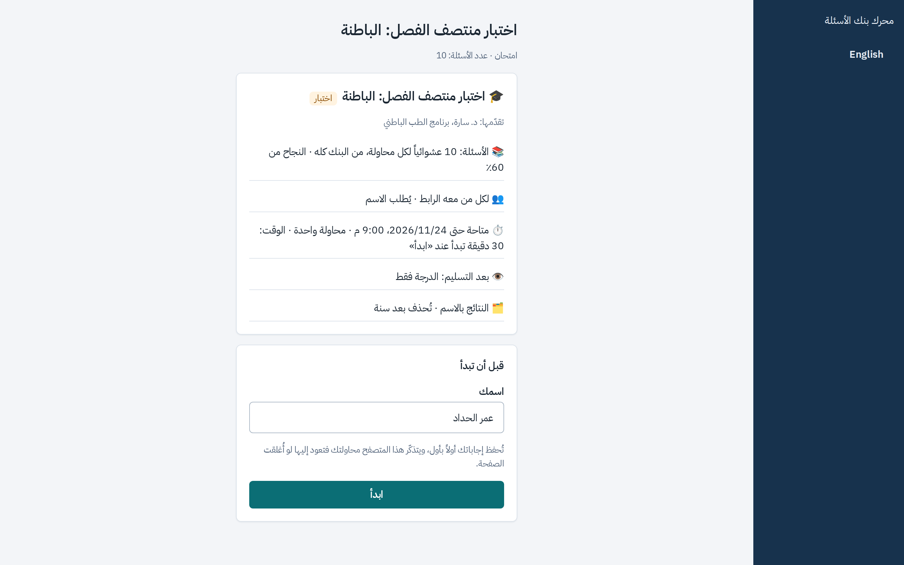

<div dir="rtl">

<div align="center">



<br>

**حوّل كتبك وملفات أسئلتك إلى بنك أسئلة خاص بك، يدقّقه ذكاؤك الاصطناعي، ثم ذاكر منه، وشارك منه
اختبارات، وشغّله على جهازك أنت.**

[](LICENSE)
[](CHANGELOG.md)
[](#-ابدأ-في-دقيقتين)
[](README.md)

[**ابدأ**](#-ابدأ-في-دقيقتين) ·
[**الميزات**](#-الميزات) ·
[**خادم لمجموعتك**](#-خادم-لزملائك-وطلابك) ·
[**الأدلة**](#-الأدلة) ·
[**English**](README.md)

<br>



</div>

<br>

## ✨ لماذا QBank

<table>
<tr>
<td width="33%" valign="top">

### 📚 مادتك أنت
تستورد الكتب والملفات التي **تملكها**. الأسئلة والخيارات ومفاتيح الإجابة والشروح والصور تبقى كما
طُبعت، وتقرير صادق يقول ما قُرئ وما ينتظر مراجعتك.

</td>
<td width="33%" valign="top">

### 🤖 ذكاؤك أنت، إن أردت
اربط اشتراكك **أنت** في Claude أو ChatGPT، أو مفتاح API. نموذجان يحلّان كل سؤال، ونموذج أقوى يحسم
الخلاف، فلا تراجع إلا ما اختلفا فيه. وكل شيء يعمل بلا ذكاء اصطناعي أيضاً.

</td>
<td width="33%" valign="top">

### 🔒 خادمك أنت
أمر واحد على جهازك أو خادمك. كل حساب يرى بنوكه وحده. لا سحابة، ولا تتبّع، ولا اشتراك عندنا. مفتوح
المصدر برخصة MIT.

</td>
</tr>
</table>

## 🚀 ابدأ في دقيقتين

> **تحتاج فقط:** [Docker](https://www.docker.com/products/docker-desktop/).

<div dir="ltr">

```bash
git clone https://github.com/eom1417/qbank.git && cd qbank
docker compose up -d          # أول مرة يبني QBank (قرابة 10 دقائق)
```

</div>

افتح **http://localhost:3000**، واضغط **«جهّز البنك التجريبي»**، فتذاكر عشرة أسئلة حقيقية خلال
دقيقة: بلا ملف، ولا ذكاء اصطناعي، ولا حساب.

<details>
<summary><b>بلا Docker؟ ثبّته مباشرة على ماك أو لينكس أو ويندوز (WSL)</b></summary>

<div dir="ltr">

```bash
git clone https://github.com/eom1417/qbank.git && cd qbank
bash scripts/install.sh
qbank
```

</div>

- **ويندوز:** شغّل `wsl --install` مرة في PowerShell، ثم `wsl bash scripts/install.sh` و`wsl qbank`.
- **على جوالك (الواي فاي نفسه):** `qbank --lan`، ثم امسح رمز QR من *الإعدادات ← أجهزتك الأخرى*.

</details>

## 🧭 الرحلة

| 1 | 2 | 3 | 4 | 5 | 6 |
| :-: | :-: | :-: | :-: | :-: | :-: |
| 🔑 **ادخل** | 🤖 **اربط ذكاءك** | 📥 **استورد** | ✅ **راجع** | 🎯 **ذاكر** | 📤 **شارك** |
| بحساب Google، أو بالبريد على خادم بلا Google | اختياري: Claude أو ChatGPT | ملفات PDF نصية أو ممسوحة، عربية أو إنجليزية | فقط ما لم يُحسم | Tutor، وامتحان بوقت، وSmart Mix | روابط اختبار، ووكلاء واتساب وتيليجرام |

## 🎯 الميزات

<table>
<tr>
<td width="50%" valign="top">

#### ذاكر كأنك في الامتحان
**Tutor** يعرض الإجابة الصحيحة وشرح الكتاب نفسه مع كل سؤال. **الامتحان بوقت** لا يكشف شيئاً قبل
التسليم، والخادم هو الذي يحسب الوقت. و**Smart Mix** والمراجعة المتباعدة تعيد ما أوشكت أن تنساه،
وتقول لماذا اختارت كل سؤال.

</td>
<td width="50%" valign="top">



</td>
</tr>
<tr>
<td width="50%" valign="top">



</td>
<td width="50%" valign="top">

#### امتحان بساعة تثق فيها
القواعد معلنة قبل البدء، وخريطة الأسئلة تتيح لك التعليم والرجوع، والوقت يفرضه الخادم لا المتصفح.

</td>
</tr>
<tr>
<td width="50%" valign="top">

#### استيراد صادق في كل مرة
صفحات نصية وممسوحة (OCR بالعربي والإنجليزي)، ومفاتيح الإجابة في آخر الملف، وملفات إجابات منفصلة،
والصور والجداول. لا يُخمَّن شيء أبداً: ما لم يُحسم ينتظر مراجعتك، والتقرير يقول ذلك.

</td>
<td width="50%" valign="top">



</td>
</tr>
<tr>
<td width="50%" valign="top">



</td>
<td width="50%" valign="top">

#### تقدّم يقول الحقيقة
الدرجة والدقة مع أساس كل رقم، وتطورك عبر الوقت، وسجل الجلسات، واقتراح للجلسة التالية. وبحث في
الأسئلة والخيارات وملاحظاتك الخاصة.

</td>
</tr>
<tr>
<td width="50%" valign="top">

#### شارك اختباراً برابط واحد
اختر قالباً (اختبار رسمي، أو تمرين مفتوح، أو سؤال يومي، أو API)، وعدّل الفصول والوقت والمحاولات وما
يُكشف بعد التسليم. بطاقة بلغة واضحة تريك بالضبط ما ستنشره. ويفتح الناس الرابط **بلا حساب**،
ويمتحنون في شاشة الامتحان نفسها، وترى أنت كل محاولة.

</td>
<td width="50%" valign="top">



</td>
</tr>
<tr>
<td width="50%" valign="top">



</td>
<td width="50%" valign="top">

#### واتساب وتيليجرام وأي وكيل ذكي
أعطِ وكيلاً خارجياً (n8n، أو بوت تيليجرام، أو أي عميل MCP) مفتاحه الخاص: يأخذ دفعات أسئلة لا تتكرر،
بالقواعد نفسها التي تحكم رابط الاختبار. أوقف المشاركة أو أنهِها أو جدّد مفتاحها فيسري ذلك على الطلب
التالي. وأسئلة الاختبار المحجوزة لا تخرج عبر أي وكيل.

</td>
</tr>
</table>

## 👥 خادم لزملائك وطلابك

شغّل خادماً واحداً لمجموعتك: كل شخص يدخل بحسابه، ويربط ذكاءه الخاص، ويبني بنوكه.

<div dir="ltr">

```bash
cp deploy/server.env.example .env      # نطاقك، وكلمة سر لقاعدة البيانات، وبريدك مديراً
sudo docker compose -f compose.server.yaml up -d --build
```

</div>

تحصل على https تلقائياً، وPostgreSQL، و**نسخ احتياطي يومي** مع نسخة اختيارية على قرص آخر، وتنبيه إن
توقف الخادم، وشاشة **«إدارة الخادم»** فيها ملاحظات المستخدمين وطابور الاستيراد وآخر نسخة احتياطية.

| طريقة الدخول | متى | ما تجهّزه |
| :-- | :-- | :-- |
| **Google** | إن وضعت عميل Google في `.env` | عشر دقائق في Google Cloud Console مرة واحدة، ولا كلمات مرور تُنسى |
| **البريد وكلمة المرور** | بلا عميل Google | لا شيء، وترسل أنت روابط الاستعادة من «إدارة الخادم» |

الدخول بـ Google يحتاج نطاق https ثابتاً (نطاقك، أو نفق Cloudflare باسم ثابت). الخطوات كاملة:
**[docs/SELF-HOST.md](docs/SELF-HOST.md)** · النسخ والاستعادة والتنبيه:
**[docs/SELF-HOST-OPERATIONS.md](docs/SELF-HOST-OPERATIONS.md)**.

## 🤖 ذكاؤك الاصطناعي

| | بلا ذكاء اصطناعي | مع ذكائك |
| :-- | :-- | :-- |
| قراءة الصفحات النصية والممسوحة | ✅ | ✅ وقراءة الصفحة كاملة للتنسيقات الصعبة |
| مفاتيح الإجابة والشروح والصور | ✅ كما طُبعت | ✅ وربط الإجابات من صفحات أخرى |
| حسم الأسئلة بلا إجابة | تنتظر مراجعتك | نموذجان وحَكَم، وجواب الملف يبقى ظاهراً |
| تحسين الأسئلة | | إكمال الخيارات، وتحسين الصياغة (الأرقام والنفي محمية)، وملخص موضوع بمصادر مفحوصة، وتنبيه الإجابات القديمة |

## 🔐 الخصوصية والأمان

- **خاص افتراضياً:** بنكك لك وحدك، ولا يخرج منه سؤال إلا بمشاركة تنشئها أنت، بقواعد تقرؤها قبل النشر.
- **على الخادم:** المدير يدير الجهاز، لكنه لا يرى بنوك أحد داخل التطبيق؛ يرى الملاحظات والطابور والنسخ فقط.
- **لا تتبّع.** الملاحظة رسالة تكتبها وترسلها بنفسك.
- **بياناتك معك:** صدّر أي بنك ملف ZIP واسترجعه في أي مكان، واحذف بنكاً أو حسابك كاملاً بعد أن ترى أثره.

## 📖 الأدلة

| الدليل | |
| :-- | :-- |
| **دليل الاستخدام** | [العربية](docs/USER-GUIDE.ar.md) · [English](docs/USER-GUIDE.md) |
| **خادم لمجموعتك** | [SELF-HOST.md](docs/SELF-HOST.md) · [التشغيل اليومي](docs/SELF-HOST-OPERATIONS.md) |
| **ربط واتساب أو تيليجرام أو وكيل MCP** | [CHANNELS.md](docs/CHANNELS.md) |
| **ما تغيّر** | [CHANGELOG.md](CHANGELOG.md) |

## 📄 الرخصة

[MIT](LICENSE): مجاني ومفتوح المصدر. تكاليفك الوحيدة جهازك، وذكاؤك الاصطناعي إن أردته.

<div align="center">
<br>
<sub>صُنع لمن يتعلّم من كتبه. إن نفعك QBank، فنجمة ⭐ تساعد غيرك أن يجده.</sub>
</div>

</div>
