<div align="center">

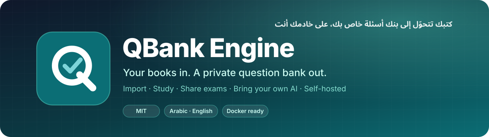

<br>

**Turn your own books and question PDFs into a private, AI-checked question bank, then study it,
share exams from it, and host it yourself.**

[](LICENSE)
[](CHANGELOG.md)
[](#-quick-start)
[](#-for-developers)
[](README.ar.md)

[**Quick start**](#-quick-start) ·
[**Features**](#-features) ·
[**How it works**](#-how-it-works) ·
[**Host it for your group**](#-host-it-for-your-group) ·
[**Docs**](#-documentation) ·
[**العربية**](README.ar.md)

<br>

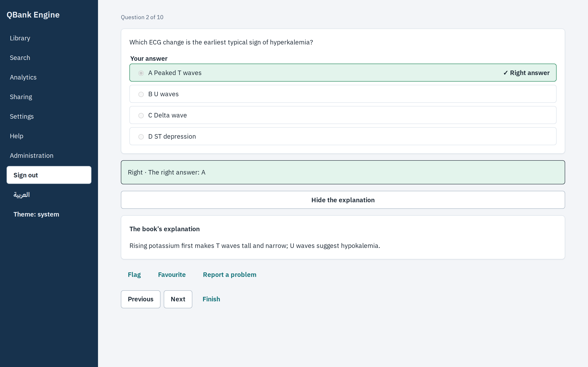

</div>

<br>

## ✨ Why QBank

<table>
<tr>
<td width="33%" valign="top">

### 📚 Your material, not ours
Import the books and question files **you** own. Questions, options, answer keys, explanations and
pictures are kept exactly as printed, and an honest report says what was read and what waits for
you.

</td>
<td width="33%" valign="top">

### 🤖 Your AI, if you want it
Connect **your own** Claude or ChatGPT subscription, or an API key. Two independent solvers and a
stronger judge settle the answers, so you only review real disagreements. Everything also works
with no AI at all.

</td>
<td width="33%" valign="top">

### 🔒 Your server, your rules
One command on your own computer or server. Every account sees only its own banks. No cloud, no
tracking, no subscription to us. MIT licensed.

</td>
</tr>
</table>

## 🚀 Quick start

> **You need:** [Docker](https://www.docker.com/products/docker-desktop/). That's it.

```bash
git clone https://github.com/eom1417/qbank.git && cd qbank
docker compose up -d          # first run builds QBank (about 10 minutes)
```

Open **http://localhost:3000**, press **Try a ready bank**, and you are studying ten real questions
within a minute: no file, no AI, no account to create.

<details>
<summary><b>No Docker? Install natively on macOS, Linux or Windows (WSL)</b></summary>

```bash
git clone https://github.com/eom1417/qbank.git && cd qbank
bash scripts/install.sh       # reading tools, packages, the build and a `qbank` command
qbank                         # starts QBank and opens it in your browser
```

- **Windows:** run `wsl --install` once in PowerShell, then `wsl bash scripts/install.sh` and `wsl qbank`.
- `bash scripts/install.sh --check` lists what is missing and changes nothing.
- **On your phone (same Wi-Fi):** `qbank --lan`, then scan the QR code in *Settings → Your other devices*.

</details>

## 🧭 The journey

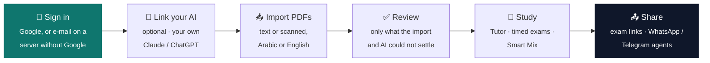

## 🎯 Features

<table>
<tr>
<td width="50%" valign="top">

#### Study like the real exam
**Tutor** shows the right answer and the book's own explanation as you go. **Timed exams** reveal
nothing until you submit, and the server keeps the clock. **Smart Mix** and spaced repetition bring
back what you are about to forget, and always say why a question was chosen.

</td>
<td width="50%" valign="top">

<p align="center">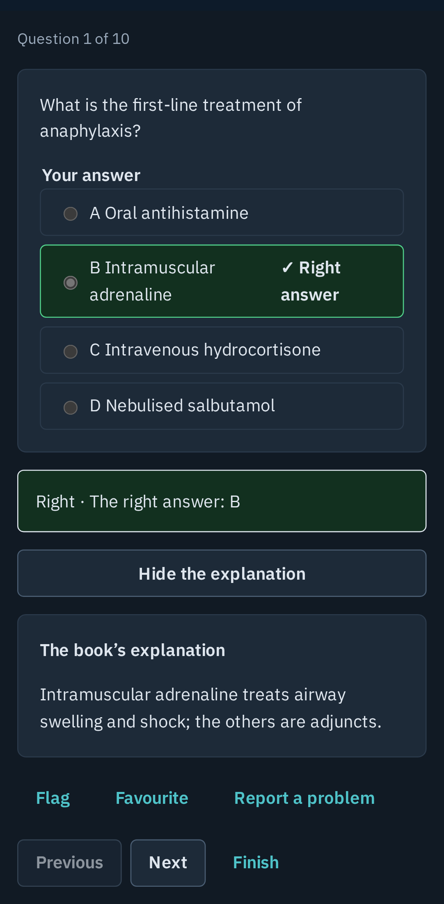</p>

</td>
</tr>
<tr>
<td width="50%" valign="top">

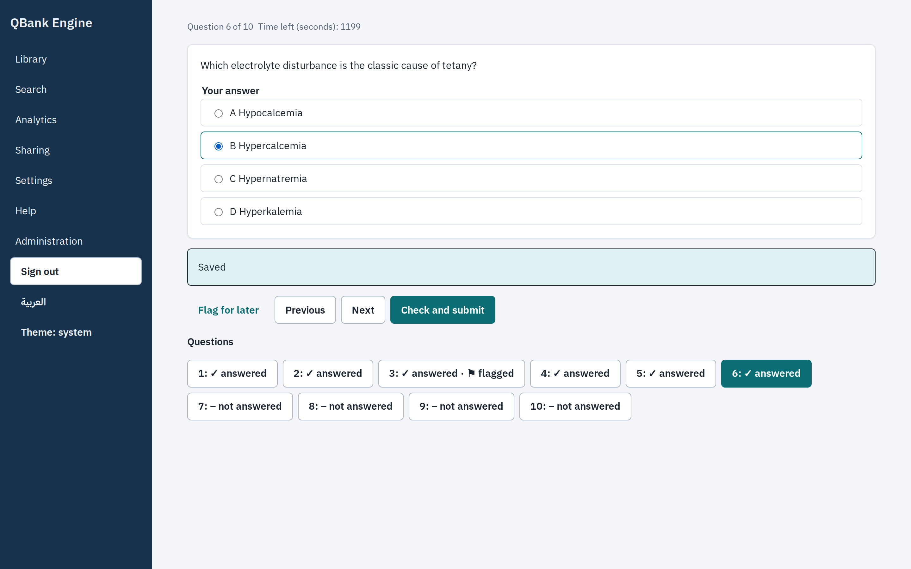

</td>
<td width="50%" valign="top">

#### Exams with a clock you can trust
Rules are stated before you start, a question map lets you flag and come back, and time is enforced
by the server, not the browser.

</td>
</tr>
<tr>
<td width="50%" valign="top">

#### An honest import, every time
Text and scanned pages (OCR in Arabic and English), answer keys at the end of a file, separate
answer files, pictures and tables. Nothing is ever guessed: what could not be settled waits for your
review, and the report says so.

</td>
<td width="50%" valign="top">

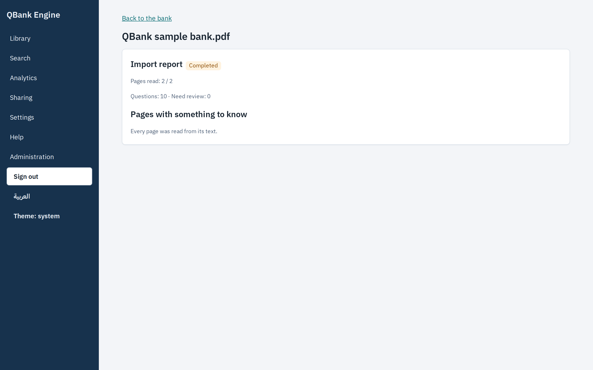

</td>
</tr>
<tr>
<td width="50%" valign="top">

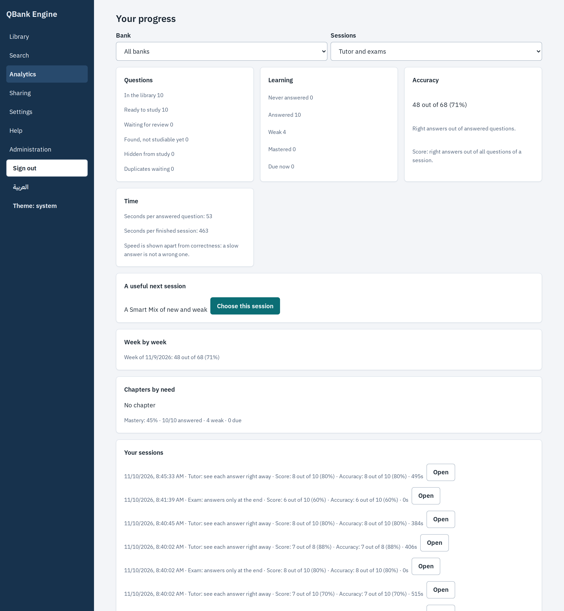

</td>
<td width="50%" valign="top">

#### Progress that tells the truth
Score and accuracy with their real basis, trends over time, session history and a suggested next
session. Search across questions, options and your private notes.

</td>
</tr>
<tr>
<td width="50%" valign="top">

#### Share an exam in one link
Pick a preset (formal exam, open practice, daily question, API), adjust chapters, timing, attempts
and what people see after submitting. A plain-language card shows exactly what you are about to
publish. People open the link with **no account**, take the exam on the same exam screen, and you
see every attempt.

</td>
<td width="50%" valign="top">

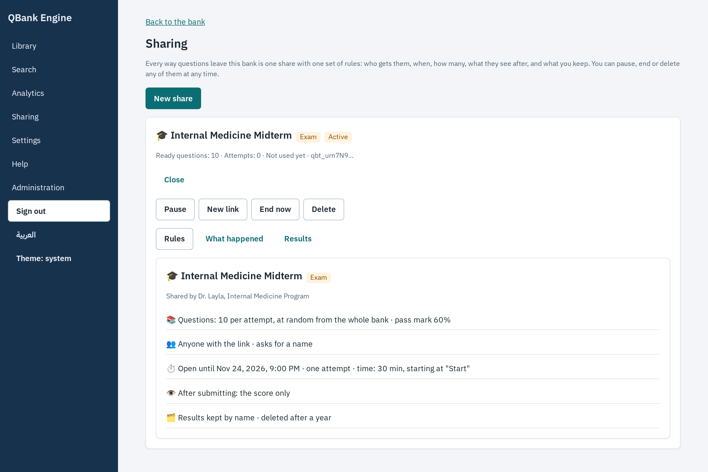

</td>
</tr>
<tr>
<td width="50%" valign="top">

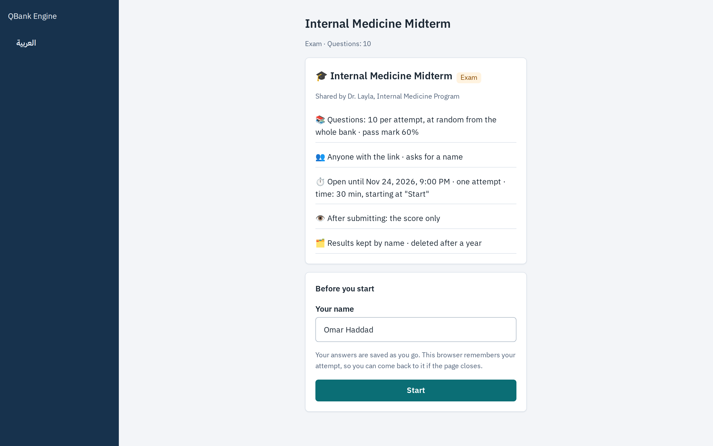

</td>
<td width="50%" valign="top">

#### WhatsApp, Telegram and any AI agent
Give an outside agent (n8n, a Telegram bot, any MCP client) its own key: it draws batches of
questions that never repeat, under the same rules as an exam link. Pause, end or renew a share and
it takes effect on the next request. Questions reserved for an exam never leave through an agent.

</td>
</tr>
</table>

<div align="center">
<sub>Installable on your phone's home screen · light and dark · four looks · Arabic (RTL) and English</sub>
</div>

## 🏗 How it works

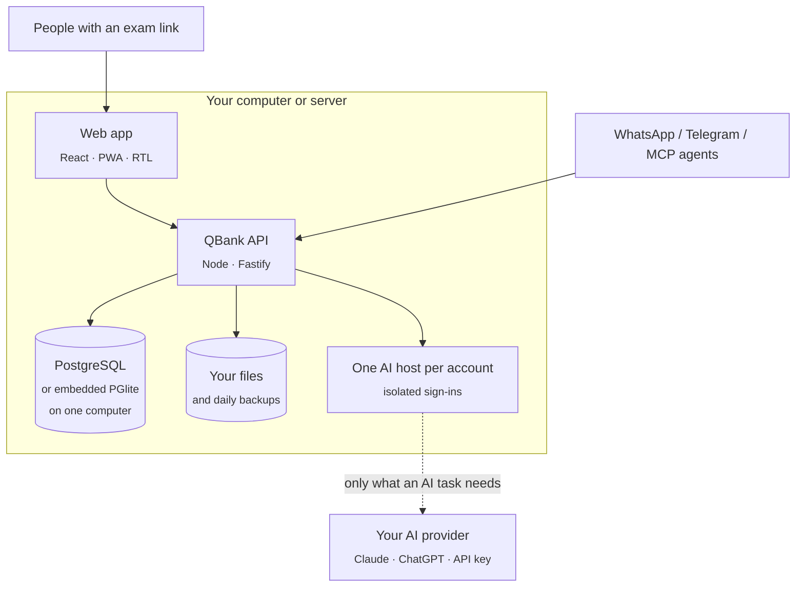

- **One gate for every share.** Exam links, practice links and agents all pass the same server-side
  policy check, and every question that leaves a bank is recorded in an append-only log.
- **Accounts are walled off.** Every query is scoped to its owner, and each account's AI sign-in lives
  in its own host and folder that nobody else can use.
- **Nothing leaves without you.** The only outbound traffic is what an AI task you started sends to
  the provider you chose.

## 👥 Host it for your group

Run one server for your colleagues, students or family: each person signs in with their own account,
links their own AI, and builds their own banks.

```bash
cp deploy/server.env.example .env      # your domain, a database password, your e-mail as operator
sudo docker compose -f compose.server.yaml up -d --build
```

You get HTTPS (Caddy, automatic certificates), PostgreSQL, **daily backups** with an optional copy to
another disk, an uptime ping, and a **Server administration** screen with users' feedback, the
import queue and the last backup.

| Sign-in | When | What you set up |
| :-- | :-- | :-- |
| **Google** | You set a Google OAuth client in `.env` | 10 minutes in Google Cloud Console, once. No passwords to forget |
| **E-mail and password** | No Google client | Nothing. You pass on reset links from Server administration |

Google sign-in needs a fixed HTTPS domain (your own, or a named Cloudflare Tunnel). Step by step:
**[docs/SELF-HOST.md](docs/SELF-HOST.md)** · backups, restore and alerts:
**[docs/SELF-HOST-OPERATIONS.md](docs/SELF-HOST-OPERATIONS.md)**.

<div align="center">
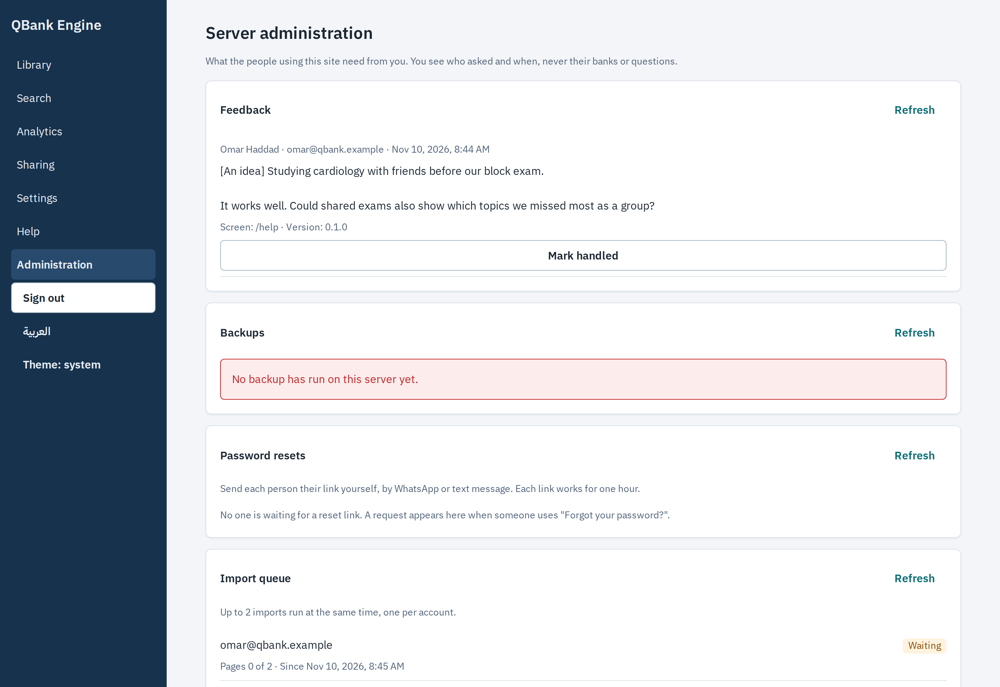
</div>

## 🤖 Bring your own AI

| | Without AI | With your AI |
| :-- | :-- | :-- |
| Read text and scanned PDFs | ✅ | ✅ and whole-page reading for hard layouts |
| Answer keys, explanations, pictures | ✅ as printed | ✅ plus answers linked from other pages |
| Settle unanswered questions | Waits for your review | Two solvers and a judge; the file's answer stays visible |
| Improve questions | | Complete options, polish wording (numbers and negations are guarded), topic reviews with checked sources, outdated-answer notes, tags, similar questions |
| Explain a question | The book's explanation | Plus your AI's own explanation on request |

Sign in to **Claude** or **ChatGPT (Codex)** right from *Settings → AI providers*, from any device,
or paste an API key. The provider tools update themselves, so new models appear on their own.

## 🔐 Privacy and security

- **Private by default:** a bank is yours alone. It leaves only through a share you create, under
  rules you can read before publishing.
- **On a server:** the operator runs the machine but sees no one's banks inside the app; they see
  feedback, the import queue and backups only.
- **No telemetry.** Feedback is a message you write and send yourself.
- **Your data is portable:** export any bank as a ZIP (with the AI's work), restore it anywhere,
  delete a bank or your whole account with an honest preview of what goes.
- Found a vulnerability? Please report it privately: **[SECURITY.md](SECURITY.md)**.

## 📖 Documentation

| Guide | |
| :-- | :-- |
| **User guide** | [English](docs/USER-GUIDE.md) · [العربية](docs/USER-GUIDE.ar.md) |
| **Host a server for a group** | [SELF-HOST.md](docs/SELF-HOST.md) · [Operations: backups, restore, alerts](docs/SELF-HOST-OPERATIONS.md) |
| **Connect WhatsApp, Telegram or an MCP agent** | [CHANNELS.md](docs/CHANNELS.md) |
| **What changed** | [CHANGELOG.md](CHANGELOG.md) |

<details>
<summary><b>❓ FAQ</b></summary>

**Do I need an AI subscription?** No. Import, review, study, exams, analytics, sharing and backups all
work without AI. With your own Claude or ChatGPT, answers get settled for you and questions improve.

**Does it work offline?** Everything except AI tasks runs on your machine.

**Can I use it in Arabic?** Yes. The whole interface is Arabic (RTL) and English, and the import reads
Arabic and English pages, including scanned ones.

**Can my students take exams without an account?** Yes. An exam link asks only for a name (and a code
if you set one). Results come to you; your own study statistics are never touched.

**Can I use Google sign-in on a server at home?** Yes, as long as it is reachable on a fixed HTTPS
domain. Otherwise leave Google out and people sign in with e-mail and password.

**Is it free?** Yes, MIT licensed. Your only costs are your machine and, if you want it, your own AI.

</details>

## 🛠 For developers

Node 24 · TypeScript · Fastify · React · Kysely · PostgreSQL / PGlite · Playwright. `bash setup.sh`
prepares a full environment (PostgreSQL for tests, browsers, hooks).

Every change passes hard gates before it lands: files ≤ 400 lines, functions ≤ 50 lines and
complexity ≤ 10, no copy-paste, design tokens only, architecture boundaries, unit, contract,
integration and end-to-end tests on desktop and phone. The engineering contract is
[AGENTS.md](AGENTS.md), the owner map [BLUEPRINT.md](BLUEPRINT.md), decisions
[docs/DECISIONS.md](docs/DECISIONS.md).

Contributions are welcome: read **[CONTRIBUTING.md](CONTRIBUTING.md)** and the
**[Code of Conduct](CODE_OF_CONDUCT.md)**.

## 📄 License

[MIT](LICENSE). Third-party notices in [NOTICE.md](NOTICE.md).

<div align="center">
<br>
<sub>Built for people who learn from their own books. If QBank helps you, a ⭐ helps others find it.</sub>
</div>
